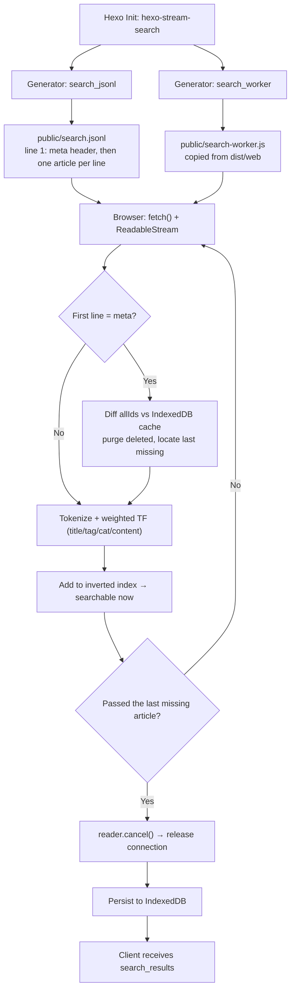

<div align="center">

# 🔍 hexo-stream-search

**Streaming, incremental, zero-dependency full-text search for Hexo 7 & 8.**  
Powered by **JSONL streaming** + **Fetch Stream** + **Intl.Segmenter** + **BM25** + **IndexedDB**.

[](https://www.npmjs.com/package/hexo-stream-search)
[](https://github.com/Wyatex/hexo-stream-search/actions/workflows/ci.yml)
[](https://nodejs.org/)
[](https://hexo.io/)
[](https://www.npmjs.com/package/hexo-stream-search)
[](LICENSE)

[English](./README.md) • [简体中文](./README.zh-CN.md)

</div>

---

## 🌟 Highlights

- ⚡ **Searchable While Downloading**: The JSONL index is parsed line by line — every article becomes searchable the moment it arrives, no need to wait for the whole file.
- 🔄 **Incremental Sync**: The first line carries the full article ID list. Unchanged articles reuse the local cache (no re-tokenization), deleted articles are purged automatically, and the stream is **cancelled early** once every remaining article is already up to date.
- 💾 **Instant First Paint**: Articles are cached in IndexedDB, so a returning visitor gets a searchable index immediately while the incremental update streams in the background.
- 🌐 **Native CJK Tokenization**: Built on V8's `Intl.Segmenter` for precise Chinese/English segmentation, with automatic normalization of technical terms (`C++` → `cpp`, `C#` → `csharp`).
- 📊 **Field-Aware BM25**: Title, tag, category and body weights are folded into the term frequency, with exact-phrase, prefix-match and full-coverage bonuses on top of the standard BM25 score.
- 📦 **Zero Runtime Dependencies**: Pure Web APIs (`fetch`, `ReadableStream`, `Intl.Segmenter`, `IndexedDB`). No dictionaries to download, no `natural`-style 100MB install, no native compilation.
- 🧩 **Cleanly Split Build Outputs**: `dist/node` (Hexo build side) and `dist/web` (browser runtime side) are fully isolated — no browser code leaks into the Node bundle and vice versa.
- 🧪 **Tested Against Real Hexo**: Full integration suites run against **Hexo 7.3.0** and **Hexo 8.1.2**, plus a zero-dependency runtime smoke test across **Node 18 → 26**.

---

## 📊 Comparison with `hexo-generator-searchdb`

| Feature | `hexo-generator-searchdb` | `hexo-stream-search` |
|:---|:---:|:---:|
| **Index artifact** | One monolithic `search.json` array | **Streamable `search.jsonl`** (meta header + one article per line) |
| **Transfer** | Whole file downloaded in one shot | **Fetch Stream, parsed line by line** |
| **Searchable at** | Only after the entire file is downloaded and parsed | **As soon as the first article arrives** |
| **Incremental update** | Not possible — no id / timestamp, so every deploy rebuilds and re-downloads everything | **Meta header + `m` timestamp diff; unchanged articles reuse the local cache** |
| **Local cache** | The whole JSON in `localStorage` (heavy, must be re-parsed on every load) | **Per-article IndexedDB records, indexed the moment they arrive** |
| **Deleted articles** | Only discovered after re-downloading the entire index | **Purged immediately via the meta header diff** |
| **Matching** | Query split into keywords, substring AND-match | **Tokenized BM25 relevance scoring** |
| **CJK support** | None — Chinese only matches contiguous substrings | **Native `Intl.Segmenter` Chinese/English segmentation** |
| **Ranking** | Hit / inclusion count (weakly related to real relevance) | **BM25 + title/tag/category weights + phrase, prefix and full-coverage bonuses** |
| **Result snippets** | Title highlight only, no surrounding context | **Context-aware snippet around the hit, with `<mark>` highlighting** |
| **Where search runs** | Main thread (blocks the UI on large corpora) | **Web Worker (never blocks the main thread)** |
| **Pages support** | `field: post / page / all` | Posts only (pages are not indexed yet) |
| **Config block** | `search.path / field / content / format` | `search.path / worker` (`field` accepted for compatibility) |
| **Theme integration** | Requires the theme's bundled `local-search.js` | **Same protocol, plus a DOM-agnostic client** |
| **Runtime dependencies** | `hexo-util` + `nunjucks` | **Zero** |
| **TypeScript types** | None | **Full declarations for both bundles** |
| **Hexo 7 & 8** | Not tested against both | **Integration-tested on Hexo 7.3 & 8.1, plus a CI matrix** |

> [!NOTE]
> Both plugins read the same `search` config block. If `hexo-generator-searchdb` is still installed, remove it — pointing both at the same file (e.g. `search.path: search.json`) makes two generators write to the same output path, and `searchdb` additionally forces a `.json` extension whenever the configured path has none.

---

## 🏗️ Architecture



---

## 📦 Installation

Install into your Hexo blog root:

```bash
# Using npm
npm install hexo-stream-search --save-dev

# Using pnpm
pnpm add -D hexo-stream-search

# Using yarn
yarn add -D hexo-stream-search
```

> [!TIP]
> Hexo automatically loads any plugin matching the `hexo-*` naming convention. No manual registration in `_config.yml` is required!

---

## ⚙️ Configuration

Add the `search` section to your blog's root `_config.yml`:

```yaml
search:
  path: search.jsonl         # Index file path (relative to the site root)
  worker: search-worker.js   # Worker script path (relative to the site root)
```

### Options Reference

| Key | Type | Default | Description |
|:---|:---:|:---:|:---|
| `search.path` | `string` | `'search.jsonl'` | Path of the generated JSONL index. A leading `/` is stripped; the file is always emitted relative to the site root. |
| `search.worker` | `string` | `'search-worker.js'` | Path of the browser worker script copied into the site root. |
| `search.field` | `string` | `'post'` | Kept for compatibility with `hexo-generator-searchdb` style configs. |

The theme reads the index URL from `CONFIG.path` (NexT exposes it as `url_for(config.search.path)`).

---

## 📄 Index Format (`search.jsonl`)

The first line is a global meta header, every following line is one article:

```jsonc
{"_type":"meta","total":186,"allIds":["a/","b/"]}
{"id":"a/","t":"标题","u":"/a/","m":1793027367870,"g":["标签"],"k":["分类"],"c":"纯文本正文"}
```

| Field | Type | Description |
|:---|:---:|:---|
| `_type` | `'meta'` | Marks the meta header (first line only). |
| `total` | `number` | Total number of published, indexable articles. |
| `allIds` | `string[]` | All valid article IDs, in the same order as the data lines. |
| `id` | `string` | Unique primary key (Hexo's `post.path`). |
| `t` | `string` | Cleaned plain-text title. |
| `u` | `string` | Absolute site URL of the article. |
| `m` | `number` | Modification timestamp in milliseconds — used for the incremental diff. |
| `g` / `k` | `string[]` | Tags / categories. |
| `c` | `string` | Plain-text body (HTML stripped, entities decoded, whitespace collapsed). |

Articles are sorted by modification time **descending**; drafts and articles with `indexing: false` are excluded.

---

## 🎨 Theme Integration

### 1. Raw Worker API

```html
<script>
  const worker = new Worker('/search-worker.js')
  worker.postMessage({ type: 'INIT', payload: { url: '/search.jsonl' } })

  worker.onmessage = (event) => {
    const { type, payload } = event.data
    if (type === 'progress') console.log(`已加载 ${payload.loaded}/${payload.total}`)
    if (type === 'sync_complete') console.log('索引就绪', payload)
    if (type === 'search_results') console.log(payload.results)
  }

  worker.postMessage({ type: 'SEARCH', payload: { query: '流式搜索', limit: 20, requestId: 1 } })
</script>
```

### 2. DOM-agnostic Client (recommended)

The packaged client handles input debouncing, `requestId` race conditions, auto re-search during streaming and worker lifecycle for you:

```js
import { createSearchClient } from 'hexo-stream-search/client'

const client = createSearchClient({
  workerUrl: '/search-worker.js',
  jsonlUrl: '/search.jsonl',
  limit: 20,
  onProgress: ({ loaded, total }) => renderProgress(loaded, total),
  onSyncComplete: ({ totalDocs }) => console.log(`${totalDocs} articles indexed`),
  onResults: ({ results, elapsedMs }) => renderResults(results, elapsedMs),
  onError: (message) => console.error(message),
})

client.init()
input.addEventListener('input', (event) => client.search(event.target.value))
```

For plain `<script>` tags use the IIFE build, which exposes the global `HexoStreamSearch`:

```html
<script src="/search-client.iife.js"></script>
<script>
  const client = HexoStreamSearch.createSearchClient({ workerUrl: '/search-worker.js' })
</script>
```

### 3. Ready-made Demo

`examples/demo.html` in this repository is a self-contained demo page — copy `search-worker.js`, `client.iife.js` and `search.jsonl` next to it and open it in a browser.

---

## 🔌 Message Protocol

### Main thread → Worker

| Command | Payload | Description |
|:---|:---|:---|
| `INIT` | `{ url?: string }` | Start syncing (defaults to `/search.jsonl`). |
| `SEARCH` | `{ query: string, limit?: number, requestId: number }` | Run a search. |
| `CLEAR` | — | Drop the IndexedDB cache. |

### Worker → Main thread

| Event | Payload | Description |
|:---|:---|:---|
| `cache_ready` | `{ count, totalTerms }` | Cached articles were indexed — search is available immediately. |
| `progress` | `{ loaded, total, percent, updated, scanned }` | Streaming progress (throttled every 40ms). |
| `sync_complete` | `{ totalDocs, totalTerms, updatedCount, deletedCount, scannedLines, canceledEarly, elapsedMs }` | Sync finished. |
| `search_results` | `{ query, requestId, results, elapsedMs }` | Search results. |
| `cleared` | `true` | Cache cleared. |
| `error` | `string` | Error message. |

---

## 🔬 Ranking Model

The engine scores documents with **BM25** and then applies field-aware bonuses.

### 1. Inverse Document Frequency
$$\text{IDF}(w) = \ln\left(1 + \frac{N - DF(w) + 0.5}{DF(w) + 0.5}\right)$$

### 2. Term Saturation & Length Normalization
$$\text{TF}_{\text{BM25}}(w, D) = \frac{\text{freq}(w, D) \cdot (k_1 + 1)}{\text{freq}(w, D) + k_1 \cdot \left(1 - b + b \cdot \frac{|D|}{\text{avgdl}}\right)}$$
*Standard constants: $k_1 = 1.5$, $b = 0.75$.*

### 3. Field Weights & Bonuses

| Signal | Value |
|:---|:---:|
| Field weights (folded into term frequency) | title **4.0** / tag **3.0** / category **2.5** / content **1.0** |
| Title contains the full query | **+8.0** (another **+4.0** when the title *starts* with it) |
| Body contains the exact phrase | **+4.0** |
| All query terms matched | **×1.6** (plus a coordination factor of $0.5 + 0.5 \cdot coverage$) |
| English prefix fallback (e.g. `types` → `typescript`) | automatic |

High-frequency Chinese stop words are filtered out for multi-word queries, and every highlight is HTML-escaped before being wrapped in `<mark class="search-keyword">`.

---

## 🛠️ Programmatic API

### Node side

```typescript
import { buildJsonl, cleanText, registerGenerators } from 'hexo-stream-search'

// Build a JSONL index from Hexo posts
const jsonl = buildJsonl(
  [
    {
      path: 'posts/docker-k8s/',
      title: 'Docker 与 Kubernetes 进阶实战',
      content: '<p>容器化编排与微服务网络治理深入剖析。</p>',
      updated: 1793027367870,
      tags: [{ name: 'DevOps' }],
      categories: [{ name: '云原生' }],
    },
  ],
  { root: '/' },
)
// jsonl → {"_type":"meta","total":1,"allIds":["posts/docker-k8s/"]}\n{"id":"posts/docker-k8s/", ...}

// Strip HTML / decode entities
cleanText('<p>Hello&nbsp;&amp;&nbsp;World</p>') // → 'Hello&nbsp; World'

// Register the generators manually (auto-registered when loaded by Hexo)
registerGenerators(hexo)
```

### Web side

```typescript
import { createSearchClient } from 'hexo-stream-search/client'

const client = createSearchClient({
  workerUrl: '/search-worker.js',
  jsonlUrl: '/search.jsonl',
  debounceMs: 90,                 // input debounce
  autoRefreshWhileSyncing: true,  // re-search while the index is still streaming
  onResults: ({ results }) => console.log(results),
})

client.init()
client.search('流式搜索')
await client.clearCache()
client.destroy()
```

---

## 🧪 Testing

The suite runs with [Vitest](https://vitest.dev/) and covers:

- HTML cleaning, entity decoding and whitespace collapsing
- `Intl.Segmenter` tokenization, technical-term normalization and the no-Segmenter fallback
- BM25 scoring, field weights, phrase bonuses and prefix fallback
- JSONL streaming: partial lines, meta header diffing, early `reader.cancel()`, deleted-article cleanup
- IndexedDB persistence, upgrade and the in-memory degradation path
- Worker protocol payloads and the client-side debounce / race handling
- Real **Hexo 7.3.0** and **Hexo 8.1.2** integration lifecycles
- A zero-dependency runtime smoke test against the built `dist`

```bash
# Run all unit + integration tests
pnpm test

# Type check
pnpm typecheck

# Build the Node and web bundles
pnpm build

# Smoke test the built artifacts
pnpm smoke
```

### CI & Release

- `.github/workflows/ci.yml`
  - `build-and-test` — type check → build → full test suite on **Node 22 / 24 / 26**, then uploads the `dist` artifact.
  - `runtime-compatibility` — downloads the artifact and runs `tests/smoke.cjs` on **Node 18 / 20 / 22 / 24 / 26**.
- `.github/workflows/release.yml` — pushing a `v*` tag builds, tests, publishes to npm with `--provenance` and creates a GitHub Release with the `dist` files.

---

## 🛡️ Graceful Degradation

| Scenario | Behaviour |
|:---|:---|
| Browser without `Intl.Segmenter` (e.g. Safari < 16.4) | Falls back to a regex tokenizer (CJK bigrams). Results stay usable, precision drops slightly. |
| IndexedDB unavailable (private mode, disabled storage) | Falls back to an in-memory cache — identical behaviour, no cross-session persistence. |
| Stream interrupted mid-way | The in-memory index built so far is kept and remains searchable. The next visit re-streams the file from the beginning, but cached articles are **not** re-tokenized and the connection is cancelled right after the last missing article — so only the changed part is transferred again. |
| Worker bundle missing at build time | The `search_worker` generator is skipped with a warning instead of failing the build. |

---

<a id="known-issue"></a>

## ⚠️ Known Issue: A Changed Article Can Be Skipped by the Early Disconnect

**Symptom** — After an article's content changes, the search index may keep serving the **old** content for that article, and the staleness persists across reloads.

**Root cause** — The early-disconnect logic only tracks articles that are *missing* from the local cache (`lastMissingIndex`). An article that **is** cached but whose `m` has changed does **not** advance that marker, so the stream can be cancelled before the client ever reaches it:

```
file order (by updated desc):  [B unchanged] [A m changed] [C unchanged]
                               ^ cancel here → A is never re-indexed
```

**Why it rarely happens** — Editing an article updates its `updated` timestamp to "now", which moves it to the **head** of the file, i.e. before the disconnect point. The bug only surfaces when the timestamp is pinned to an older date in the front-matter (`updated: 2024-01-01`) or when two articles share the exact same `updated` value and the sort order flips between builds.

**Impact** — Low probability, but the stale entry is self-perpetuating: every following sync cancels at the same position.

**Workaround** — Let Hexo manage the timestamp (omit `updated:` from the front-matter). The article then moves to the head of the index and is always re-indexed.

**Planned fix** — Carry a `{ id, m }` snapshot of the first N articles in the meta header so the client can compute the *exact* first divergent position instead of guessing it. See the roadmap below.

---

## 🗺️ Roadmap

- [ ] **HTTP Range resume for the index file** — send `Range: bytes=<offset>-` (with `If-Range` / `ETag`) so an interrupted sync continues from the last received byte instead of re-streaming the file from the beginning. Needs: the `ETag` / `Last-Modified` of the index exposed to the client, the last received offset persisted in IndexedDB, and a graceful fallback to today's full-stream behaviour when the server does not support byte ranges.
- [ ] **Exact divergence detection** — ship a `{ id, m }` head snapshot in the meta header so the disconnect point is computed precisely, closing the [known issue](#known-issue) above.
- [ ] **Index pages as well as posts** — `hexo-generator-searchdb` can index `locals.pages` via `search.field: page | all`; this package currently indexes posts only.

---

## 🔄 Migration from `hexo-generator-searchdb`

1. Remove `hexo-generator-searchdb` from your dependencies — it registers its own generator against the same `search` config block, so both would fight over the same output file.
2. Add this package: `"hexo-stream-search": "file:../path/to/hexo-stream-search"` (or the published version).
3. Delete any hand-written `scripts/jsonl-generator.js` and `search-worker.js`.
4. Point the theme at the new index — NexT reads it from `CONFIG.path`, which is derived from `search.path` (`search.jsonl` by default).
5. Your theme script can keep using the original protocol, or switch to `hexo-stream-search/client` to reuse the debounce and auto re-search logic.

---

## 📄 License

[MIT](./LICENSE) © [Wyatex](https://github.com/wyatex)
