<div align="center">

# 🔍 hexo-stream-search

**Streaming, incremental, zero-dependency full-text search for Hexo 7 & 8.**  
Powered by **JSONL streaming** + **HTTP Range Resumption** + **Deterministic Divergence Detection** + **Intl.Segmenter** + **BM25** + **Multi-Store IndexedDB**.

[](https://www.npmjs.com/package/hexo-stream-search)
[](https://github.com/Wyatex/hexo-stream-search/actions/workflows/ci.yml)
[](https://nodejs.org/)
[](https://hexo.io/)
[](https://www.npmjs.com/package/hexo-stream-search)
[](LICENSE)

[English](./README.md) • [简体中文](./README.zh-CN.md)

</div>

---

## 🌟 Highlights

- ⚡ **Searchable While Downloading**: The JSONL index is parsed line by line — every article becomes searchable the moment it arrives, no need to wait for the entire file to download.
- 🔄 **Incremental Sync & Exact Divergence Detection**: The first line carries full-site ID and timestamp snapshots (`allIds` and `allM`). The client calculates the exact divergence boundary in $O(\text{total})$ time. If all articles are up to date, it triggers a **Line 1 zero-byte early abort**; otherwise, it cancels the stream the moment all changed articles have arrived.
- 📶 **HTTP Range Resumption**: Interrupted streams resume from the exact byte offset using `Range: bytes=<offset>-` and `If-Range: <etag>`. Survives page refreshes, tab closures, and mobile network handoffs without re-downloading previously processed articles.
- 💾 **Multi-Store Atomic Persistence**: IndexedDB uses isolated `posts` and `meta` stores committed together in single-transaction atomic batches (`applyBatch`), preventing split-state tearing across page reloads. Returning visitors get an instant searchable index while incremental sync runs quietly in the background.
- 🛡️ **Resilient State Machine**: Comprehensive handling of HTTP 206 (Range resume), 200 (graceful full fallback with automatic dirty cache eviction — 0 ghost posts), 304 (instant 0-byte cache validation), and 416 (automatic range reset and retry).
- 🌐 **Native CJK Tokenization**: Built on V8's native `Intl.Segmenter` for precise Chinese/English segmentation, with automatic normalization of technical terms (`C++` → `cpp`, `C#` → `csharp`).
- 📊 **Field-Aware BM25**: Title, tag, category, and body weights are folded into the term frequency, with exact-phrase, prefix-match, and full-coverage bonuses on top of the standard BM25 score.
- 📦 **Zero Runtime Dependencies**: Pure Web APIs (`fetch`, `ReadableStream`, `Intl.Segmenter`, `IndexedDB`). No dictionaries to download, no heavy natural-language libraries, no native compilation.
- 🧩 **Cleanly Split Build Outputs**: `dist/node` (Hexo build side) and `dist/web` (browser runtime side) are fully isolated — no browser code leaks into the Node bundle and vice versa.
- 🧪 **Battle-Tested & Verified**: 206 unit, integration, and end-to-end resilience stress tests across **Hexo 7.3.0** and **Hexo 8.1.2**, plus a zero-dependency runtime smoke test across **Node 18 → 26**.

---

## 📊 Comparison with `hexo-generator-searchdb`

| Feature | `hexo-generator-searchdb` | `hexo-stream-search` |
|:---|:---:|:---:|
| **Index artifact** | One monolithic `search.json` array | **Streamable `search.jsonl`** (meta header + one article per line) |
| **Transfer** | Whole file downloaded in one shot | **Fetch Stream, parsed line by line** |
| **Searchable at** | Only after the entire file is downloaded and parsed | **As soon as the first article arrives** |
| **HTTP Range resumption** | ❌ Not supported (re-downloads whole file on interruption) | **✅ Supported (`Range` + `If-Range`, resumes from byte offset)** |
| **Incremental update** | ❌ None — no id / timestamp snapshot, rebuilds & re-downloads everything | **✅ Exact `allM` diffing + Line 1 zero-byte early abort** |
| **Post sorting determinism** | ❌ Arbitrary / unstable across builds | **✅ Deterministic sort (`updated` desc + `path` tie-breaker)** |
| **Local cache** | Whole JSON in `localStorage` (heavy, re-parsed every load) | **Multi-store IndexedDB (`posts` + `meta`) with atomic batch commits** |
| **Deleted articles** | Only discovered after re-downloading entire index | **Purged immediately at Line 1 via meta header diff** |
| **State recovery on reload** | Re-downloads full file | **Resumes from persisted `byteOffset` via HTTP 206** |
| **Fallback resilience** | Fails completely on transfer interruption | **Resilient state machine (206 / 200 / 304 / 416) + MemoryStore fallback** |
| **Matching** | Query split into keywords, substring AND-match | **Tokenized BM25 relevance scoring** |
| **CJK support** | None — Chinese only matches contiguous substrings | **Native `Intl.Segmenter` Chinese/English segmentation** |
| **Ranking** | Hit / inclusion count (weakly related to real relevance) | **BM25 + title/tag/category weights + phrase, prefix, and full-coverage bonuses** |
| **Result snippets** | Title highlight only, no surrounding context | **Context-aware snippet around the hit, with `<mark>` highlighting** |
| **Where search runs** | Main thread (blocks UI on large blogs) | **Web Worker (never blocks the main thread)** |
| **Pages support** | `field: post / page / all` | Posts only (pages are scheduled on the roadmap) |
| **Config block** | `search.path / field / content / format` | `search.path / worker` (`field` accepted for compatibility) |
| **Theme integration** | Requires theme's bundled `local-search.js` | **Same protocol, plus a DOM-agnostic client** |
| **Runtime dependencies** | `hexo-util` + `nunjucks` | **Zero runtime dependencies** |
| **TypeScript types** | None | **Full declarations for both Node and Web bundles** |
| **Hexo 7 & 8** | Not tested against both | **Integration-tested on Hexo 7.3 & 8.1, plus a CI matrix** |

> [!NOTE]
> Both plugins read the same `search` config block. If `hexo-generator-searchdb` is still installed, remove it — pointing both at the same file (e.g. `search.path: search.json`) makes two generators write to the same output path, and `searchdb` additionally forces a `.json` extension whenever the configured path has none.

---

## 🏗️ Architecture

```mermaid
flowchart TD
    subgraph Build["Hexo Build Phase (Node.js)"]
        A["Hexo Init: hexo-stream-search"] --> B["Generator: search_jsonl"]
        A --> C["Generator: search_worker"]
        B --> D["Deterministic Sorting<br/>(updated desc + post.path tie-breaker)"]
        D --> E["public/search.jsonl<br/>Line 1: Meta { total, allIds, allM }<br/>Lines 2..N: JSONL Post records"]
        C --> F["public/search-worker.js<br/>(copied from dist/web)"]
    end

    subgraph Runtime["Browser Client & Web Worker"]
        G["Client / Worker Init"] --> H["Load IndexedDB Cache<br/>(posts & meta stores)"]
        H --> I{"Cached syncState exists?"}
        I -- "byteOffset > 0 & status: syncing" --> J["Send HTTP Range Request<br/>Range: bytes=offset-<br/>If-Range: etag / lastModified"]
        I -- "status: completed" --> K["Send Conditional Request<br/>If-None-Match: etag"]
        I -- "No cache" --> L["Send Full Request (from byte 0)"]

        J --> M{"Response Status"}
        K --> M
        L --> M

        M -- "304 Not Modified" --> N["0 Bytes Transferred<br/>Instant Cache Complete"]
        M -- "416 Range Not Satisfiable" --> O["Discard offset<br/>Retry Full Fetch (byte 0)"]
        O --> M
        M -- "200 OK (Full Fetch / Fallback)" --> P["Evict dirty partial cache<br/>Parse Line 1 Meta"]
        M -- "206 Partial Content (Range Resume)" --> Q["Restore Meta from syncState<br/>Resume from byte offset"]

        P --> R["Compute lastDivergentIndex<br/>from allM & local cache"]
        R --> S{"lastDivergentIndex === -1?"}
        S -- Yes --> T["Line 1 Zero-Byte Abort<br/>reader.cancel() → Done"]
        S -- No --> U["Stream Post Lines"]

        Q --> U
        U --> V["Uint8Array 0x0A Scan<br/>Strict Line-Boundary Alignment"]
        V --> W["Tokenize + Weighted TF<br/>(title / tag / category / content)"]
        W --> X["Insert into Inverted Index<br/>(Instantly Searchable)"]
        X --> Y{"currentIndex > lastDivergentIndex?"}
        Y -- Yes --> Z["reader.cancel() Early Disconnect"]
        Y -- No --> AA{"More stream chunks?"}
        AA -- Yes --> U
        AA -- No (Natural EOF) --> AB["Natural EOF Completion"]

        Z --> AC["Multi-Store Atomic Commit<br/>applyBatch('posts' + 'meta')"]
        AB --> AC
        T --> AC
        AC --> AD["Ready for Search Queries"]
    end
```



---

## 📦 Installation

Install into your Hexo blog root:

```bash
# Using npm
npm install hexo-stream-search --save-dev

# Using pnpm
pnpm add -D hexo-stream-search

# Using yarn
yarn add -D hexo-stream-search
```

> [!TIP]
> Hexo automatically discovers and activates any plugin matching the `hexo-*` naming convention. No manual registration in `_config.yml` is required!

---

## ⚙️ Configuration

Add the `search` section to your blog's root `_config.yml`:

```yaml
search:
  path: search.jsonl         # Index file path (relative to the site root)
  worker: search-worker.js   # Worker script path (relative to the site root)
```

### Options Reference

| Key | Type | Default | Description |
|:---|:---:|:---:|:---|
| `search.path` | `string` | `'search.jsonl'` | Path of the generated JSONL index. A leading `/` is stripped; the file is always emitted relative to the site root. |
| `search.worker` | `string` | `'search-worker.js'` | Path of the browser worker script copied into the site root. |
| `search.field` | `string` | `'post'` | Kept for compatibility with `hexo-generator-searchdb` style configs. |

The theme reads the index URL from `CONFIG.path` (NexT exposes it as `url_for(config.search.path)`).

---

## 📄 Index Format (`search.jsonl`)

The first line is a global meta header, and every subsequent line is an individual article record:

```jsonc
{"_type":"meta","total":186,"allIds":["posts/docker/","posts/k8s/"],"allM":[1793027367870,1793026000000]}
{"id":"posts/docker/","t":"Docker 架构与实战","u":"/posts/docker/","m":1793027367870,"g":["DevOps"],"k":["云原生"],"c":"容器化编排与微服务治理深入剖析..."}
```

### Meta Record Fields (Line 1)

| Field | Type | Description |
|:---|:---:|:---|
| `_type` | `'meta'` | Identifies the meta header (first line only). |
| `total` | `number` | Total number of published, indexable articles on the site. |
| `allIds` | `string[]` | Complete array of article IDs in deterministic sort order. |
| `allM` | `number[]` | Full-site modification timestamps in exact 1-to-1 index correspondence with `allIds`. Enables $O(\text{total})$ exact divergence detection and Line 1 zero-byte early abort. |

### Post Record Fields (Lines 2..N)

| Field | Type | Description |
|:---|:---:|:---|
| `id` | `string` | Unique primary key (Hexo's `post.path`). |
| `t` | `string` | Cleaned plain-text title. |
| `u` | `string` | Absolute site URL of the article. |
| `m` | `number` | Modification timestamp in milliseconds — used for incremental cache diffing. |
| `g` / `k` | `string[]` | Tags (`g`) and categories (`k`). |
| `c` | `string` | Plain-text body (HTML stripped, entities decoded, whitespace collapsed). |

> [!IMPORTANT]
> Articles are sorted deterministically by modification timestamp **descending**, with `post.path` as an unambiguous tie-breaker. Drafts and posts with `indexing: false` are excluded at build time.

---

## 🎨 Theme Integration

### 1. Raw Worker API

```html
<script>
  const worker = new Worker('/search-worker.js')
  worker.postMessage({ type: 'INIT', payload: { url: '/search.jsonl' } })

  worker.onmessage = (event) => {
    const { type, payload } = event.data
    if (type === 'cache_ready') console.log(`Instant cache ready with ${payload.count} articles`)
    if (type === 'progress') console.log(`Loaded ${payload.loaded}/${payload.total} (${payload.percent}%)`)
    if (type === 'sync_complete') console.log('Index fully synced', payload)
    if (type === 'search_results') console.log(payload.results)
  }

  worker.postMessage({ type: 'SEARCH', payload: { query: '流式搜索', limit: 20, requestId: 1 } })
</script>
```

### 2. DOM-Agnostic Client (Recommended)

The bundled client handles input debouncing, `requestId` race resolution, automatic re-searching during streaming, and worker lifecycle management:

```js
import { createSearchClient } from 'hexo-stream-search/client'

const client = createSearchClient({
  workerUrl: '/search-worker.js',
  jsonlUrl: '/search.jsonl',
  limit: 20,
  debounceMs: 90,
  autoRefreshWhileSyncing: true,
  onProgress: ({ loaded, total }) => renderProgress(loaded, total),
  onSyncComplete: ({ totalDocs, resumed }) => console.log(`${totalDocs} articles ready (resumed: ${resumed})`),
  onResults: ({ results, elapsedMs }) => renderResults(results, elapsedMs),
  onError: (message) => console.error(message),
})

client.init()
input.addEventListener('input', (event) => client.search(event.target.value))
```

For plain `<script>` tags, include the IIFE build which exposes the global `HexoStreamSearch`:

```html
<script src="/search-client.iife.js"></script>
<script>
  const client = HexoStreamSearch.createSearchClient({ workerUrl: '/search-worker.js' })
  client.init()
</script>
```

### 3. Ready-Made Demo

`examples/demo.html` in this repository is a self-contained demo page — copy `search-worker.js`, `client.iife.js`, and `search.jsonl` next to it and open it directly in a browser.

---

## 🔌 Message Protocol

### Main Thread → Worker

| Command | Payload | Description |
|:---|:---|:---|
| `INIT` | `{ url?: string }` | Start syncing (defaults to `/search.jsonl`). |
| `SEARCH` | `{ query: string, limit?: number, requestId: number }` | Execute a search query. |
| `CLEAR` | — | Drop the IndexedDB cache and reset state. |

### Worker → Main Thread

| Event | Payload | Description |
|:---|:---|:---|
| `cache_ready` | `{ count, totalTerms }` | Cached articles restored from IndexedDB — search is available immediately. |
| `progress` | `{ loaded, total, percent, updated, scanned }` | Streaming progress (throttled at 40ms intervals). |
| `sync_complete` | `{ totalDocs, totalTerms, updatedCount, deletedCount, scannedLines, canceledEarly, elapsedMs, resumed }` | Sync finished. `resumed` indicates Range 206 or 304 hit. |
| `search_results` | `{ query, requestId, results, elapsedMs }` | Search results ordered by BM25 relevance score. |
| `cleared` | `true` | Cache successfully dropped. |
| `error` | `string` | Error description. |

---

## 🔬 Ranking Model

The search engine scores documents using **BM25** and applies field-aware bonuses:

### 1. Inverse Document Frequency (IDF)
$$\text{IDF}(w) = \ln\left(1 + \frac{N - DF(w) + 0.5}{DF(w) + 0.5}\right)$$

### 2. Term Saturation & Length Normalization
$$\text{TF}_{\text{BM25}}(w, D) = \frac{\text{freq}(w, D) \cdot (k_1 + 1)}{\text{freq}(w, D) + k_1 \cdot \left(1 - b + b \cdot \frac{|D|}{\text{avgdl}}\right)}$$
*Standard constants: $k_1 = 1.5$, $b = 0.75$.*

### 3. Field Weights & Scoring Signals

| Signal | Value |
|:---|:---:|
| Field weights (folded into term frequency) | title **4.0** / tag **3.0** / category **2.5** / content **1.0** |
| Title contains the full query | **+8.0** (additional **+4.0** when title *starts* with it) |
| Body contains the exact phrase | **+4.0** |
| All query terms matched | **×1.6** (plus coordination factor $0.5 + 0.5 \cdot \text{coverage}$) |
| English prefix fallback (e.g. `types` → `typescript`) | Automatic |

High-frequency Chinese and English stop words are filtered out for multi-word queries, and every snippet highlight is safely HTML-escaped before being wrapped in `<mark class="search-keyword">`.

---

## 🛠️ Programmatic API

### Node Side

```typescript
import { buildJsonl, cleanText, registerGenerators } from 'hexo-stream-search'

// Build a JSONL index from Hexo posts
const jsonl = buildJsonl(
  [
    {
      path: 'posts/docker-k8s/',
      title: 'Docker 与 Kubernetes 进阶实战',
      content: '<p>容器化编排与微服务网络治理深入剖析。</p>',
      updated: 1793027367870,
      tags: [{ name: 'DevOps' }],
      categories: [{ name: '云原生' }],
    },
  ],
  { root: '/' },
)

// Strip HTML / decode HTML entities
cleanText('<p>Hello&nbsp;&amp;&nbsp;World</p>') // → 'Hello&nbsp; World'

// Register generators manually (automatically registered when loaded by Hexo)
registerGenerators(hexo)
```

### Web Side

```typescript
import { createSearchClient } from 'hexo-stream-search/client'

const client = createSearchClient({
  workerUrl: '/search-worker.js',
  jsonlUrl: '/search.jsonl',
  debounceMs: 90,
  autoRefreshWhileSyncing: true,
  onResults: ({ results }) => console.log(results),
})

client.init()
client.search('流式搜索')
await client.clearCache()
client.destroy()
```

---

## 🧪 Testing & Verification

The project is thoroughly tested using [Vitest](https://vitest.dev/) with **15 test suites and 206 test cases**:

- HTML cleaning, entity decoding, and whitespace collapsing.
- `Intl.Segmenter` tokenization, technical-term normalization, and regex fallback.
- BM25 scoring, field weights, exact phrase bonuses, and prefix matching.
- JSONL streaming: partial lines, byte-boundary alignment (`0x0A`), meta diffing, early abort, and deleted post cleanup.
- HTTP Range 206 resumption, ETag/If-Range validation, and interrupted stream recovery across multiple refresh cycles.
- Resilient state machine: HTTP 200 fallback with dirty cache eviction, 416 retry, and 304 instant finish.
- IndexedDB multi-store architecture (`posts` and `meta`), single-transaction atomic batching (`applyBatch`), and in-memory degradation.
- Client debouncing, `requestId` race condition handling, and worker protocol contracts.
- Real **Hexo 7.3.0** and **Hexo 8.1.2** full lifecycle integration tests.
- Zero-dependency runtime smoke tests across **Node 18 → 26**.

```bash
# Run all unit, integration, and stress tests
pnpm test

# Run TypeScript type check
pnpm typecheck

# Build both Node and Web production bundles
pnpm build

# Run runtime smoke test on built artifacts
pnpm smoke
```

### CI & Release Automation

- `.github/workflows/ci.yml`:
  - `build-and-test`: Type check → build → full test suite on **Node 22 / 24 / 26**, uploading the `dist` artifact.
  - `runtime-compatibility`: Runs `tests/smoke.cjs` across **Node 18 / 20 / 22 / 24 / 26**.
- `.github/workflows/release.yml`: Pushing a `v*` tag triggers build, test, npm publish with `--provenance`, and GitHub Release generation.

---

## 🛡️ Graceful Degradation Matrix

The engine is engineered to handle real-world network turbulence, legacy environments, and restricted browser sandbox modes gracefully:

| Scenario / Failure Mode | Fallback Behaviour & Recovery Strategy |
|:---|:---|
| **Server lacks HTTP Range support** | Server returns `200 OK` instead of `206 Partial Content`. The client detects the full response, automatically evicts any uncompleted partial cache from previous interrupted sessions to prevent ghost posts, resets `byteOffset` to 0, and safely ingests the full stream. |
| **Server ETag / Last-Modified changed** | If the remote index is updated while a resume request is in flight, `If-Range` validation fails and the server serves `200 OK`. The client discards outdated partial cache and streams the new index cleanly from byte 0. |
| **HTTP 416 Range Not Satisfiable** | Occurs if the remote index shrinks or the cached byte offset is invalidated. The client catches the 416 status, immediately resets `byteOffset` to 0, and automatically retries a full fetch. |
| **HTTP 304 Not Modified** | When the index has not changed since the last completed sync, the server responds with 304. The client completes immediately with 0 bytes transferred, serving the existing IndexedDB index instantly. |
| **IndexedDB unavailable** (private browsing, storage quotas, disabled storage) | Transparently falls back to `MemoryStore`. Search and streaming work identically in memory for the active session, with persistence safely bypassed. |
| **Legacy JSONL without `allM`** | Safely falls back to `allIds` missing-ID diffing mode (`lastMissingIndex`), ensuring 100% backward compatibility with index files generated by earlier plugin versions. |
| **Browser lacks `Intl.Segmenter`** (e.g. Safari < 16.4) | Automatically falls back to a regex CJK bigram tokenizer. Search remains functional with a minor drop in segmentation granularity. |
| **Worker bundle missing at build time** | The `search_worker` generator logs a warning and gracefully skips rather than crashing the Hexo site build. |

## 🗺️ Roadmap

- [x] **HTTP Range resume for the index file** — Resumes interrupted index downloads from the last committed byte offset using `Range: bytes=<offset>-` and `If-Range` validation. *(Built-in)*
- [x] **Exact divergence detection (`allM` snapshot)** — Transmits full-site timestamp snapshot in Line 1 meta header to compute exact divergence points and enable Line 1 zero-byte abort. *(Built-in)*
- [ ] **Index pages as well as posts** — Support indexing `locals.pages` via `search.field: page | all` (matching `hexo-generator-searchdb` parity).
- [ ] **Pre-tokenized index option** — Optional build-time tokenization mode for ultra-low-power devices.

---

## 🔄 Migration from `hexo-generator-searchdb`

1. Remove `hexo-generator-searchdb` from your `package.json` dependencies — both plugins hook into the same `search` configuration block and would contest the output path.
2. Install this package:
   ```bash
   npm install hexo-stream-search --save-dev
   ```
3. Remove any custom `scripts/jsonl-generator.js` or `search-worker.js` legacy scripts.
4. Verify your theme configuration points to the index URL (NexT reads `CONFIG.path`, which is derived from `search.path`, defaulting to `search.jsonl`).
5. Your theme's existing search script will continue to work, or you can switch to `hexo-stream-search/client` to take advantage of automatic debouncing and background streaming refresh.

---

## 📄 License

[MIT](./LICENSE) © [Wyatex](https://github.com/wyatex)
