<div align="center">

# 🔍 hexo-stream-search

**面向 Hexo 7 与 Hexo 8 的流式、增量、零依赖全文搜索方案。**  
基于 **JSONL 流式传输** + **HTTP Range 断点续传** + **确定性差异比对** + **Intl.Segmenter** + **BM25** + **多 Store IndexedDB** 驱动。

[](https://www.npmjs.com/package/hexo-stream-search)
[](https://github.com/Wyatex/hexo-stream-search/actions/workflows/ci.yml)
[](https://nodejs.org/)
[](https://hexo.io/)
[](https://www.npmjs.com/package/hexo-stream-search)
[](LICENSE)

[English](./README.md) • [简体中文](./README.zh-CN.md)

</div>

---

## 🌟 核心亮点

- ⚡ **边下载边可搜**：JSONL 索引逐行流式解析——每篇文章到达后立即可搜，无需等待整个文件下载完成。
- 🔄 **增量同步与确切差异检测**：首行携带全站文章 ID 与时间戳快照（`allIds` 与 `allM`）。客户端在 $O(\text{total})$ 时间内计算确切差异边界。若文章均已是最新，触发**首行 0 字节提前断流**（Line 1 zero-byte early abort）；否则在变更文章全部接收完成后立即断流。
- 📶 **HTTP Range 断点续传**：网络中断或页面刷新后，客户端基于 `Range: bytes=<offset>-` 与 `If-Range: <etag>` 精确恢复。在页面刷新、标签页关闭、移动网络切换后继续流式拉取，无需重复下载已解析文章。
- 💾 **多 Store 事务原子持久化**：IndexedDB 隔离 `posts` 与 `meta` store，通过单事务原子批提交（`applyBatch`），杜绝多标签页及页面刷新导致的状态撕裂。二次访问立即可搜，后台静默增量同步。
- 🛡️ **高可用韧性状态机**：完备处理 HTTP 206（Range 续传）、200（优雅回退并自动淘汰脏缓存且 0 幽灵文章）、304（瞬时 0 字节完成校验）、416（自动重置 offset 并全量重试）。
- 🌐 **原生级中英文分词**：基于 V8 原生 `Intl.Segmenter` 精准切分中英文，自动规范化技术词汇（`C++` → `cpp`、`C#` → `csharp`）。
- 📊 **字段感知 BM25**：标题、标签、分类、正文加权统计词频，并在标准 BM25 之上叠加短语精确命中、前缀回退与全词覆盖加成。
- 📦 **零运行时依赖**：纯 Web API 实现（`fetch`、`ReadableStream`、`Intl.Segmenter`、`IndexedDB`）。无需下载分词字典，无重量级自然语言处理库，无需原生编译。
- 🧩 **构建产物清晰分段**：`dist/node`（Hexo 构建侧）与 `dist/web`（浏览器运行侧）完全隔离——浏览器代码不泄漏至 Node 产物，反之亦然。
- 🧪 **严苛工程验证**：206 项单元、集成与端到端高可用韧性测试，覆盖 **Hexo 7.3.0** 与 **Hexo 8.1.2**，另有覆盖 **Node 18 → 26** 的零依赖运行时冒烟测试。

---

## 📊 与 `hexo-generator-searchdb` 对比

| 特性 | `hexo-generator-searchdb` | `hexo-stream-search` |
|:---|:---:|:---:|
| **索引产物** | 单个庞大的 `search.json` 数组 | **可流式解析的 `search.jsonl`**（meta 头 + 每行一篇文章） |
| **传输方式** | 整文件一次性下载 | **Fetch Stream 逐行流式解析** |
| **可检索时机** | 必须等整个文件下载并解析完成 | **第一篇文章到达即可检索** |
| **HTTP Range 断点续传** | ❌ 不支持（传输中断需重新下载整文件） | **✅ 原生支持（`Range` + `If-Range`，从中断字节偏移处精确恢复）** |
| **增量更新** | ❌ 无——无 id / 时间戳快照，每次全量重建重拉 | **✅ 确切 `allM` 差异比对 + 首行 0 字节提前断流** |
| **文章排序确定性** | ❌ 构建间不稳定 / 随机波动 | **✅ 确定性排序（`updated` 降序 + `path` 破平稳定次序）** |
| **本地缓存** | 整份 JSON 塞进 `localStorage`（体积大、每次重新反序列化） | **多 Store IndexedDB（`posts` + `meta`）原子事务批提交** |
| **已删除文章** | 需重新下载整个索引后才发现 | **首行通过 meta 头比对即刻清理** |
| **页面刷新状态恢复** | 重新全量下载文件 | **基于持久化的 `byteOffset` 发起 HTTP 206 续传** |
| **降级韧性** | 传输中断直接报错失效 | **高可用状态机（206 / 200 / 304 / 416）+ MemoryStore 内存降级** |
| **匹配方式** | 查询词拆分后做子串 AND 匹配 | **分词 + BM25 相关性打分** |
| **中文支持** | 无——中文只能命中连续子串 | **原生 `Intl.Segmenter` 中英文分词** |
| **排序质量** | 命中次数 / 包含次数（与真实相关性关联很弱） | **BM25 + 标题/标签/分类加权 + 短语、前缀、全词覆盖加成** |
| **结果摘要** | 仅高亮标题，无正文上下文 | **自动定位命中位置生成带上下文的高亮摘要（`<mark>`）** |
| **搜索计算位置** | 主线程（大文章量下阻塞 UI 交互） | **Web Worker（完全不阻塞主线程）** |
| **页面 (pages) 支持** | `field: post / page / all` | 目前仅收录文章（pages 已排期在路线图） |
| **配置块** | `search.path / field / content / format` | `search.path / worker`（兼容接收 `field`） |
| **主题接入** | 依赖主题内置的 `local-search.js` | **协议一致，并额外提供与 DOM 解耦的高级 Client** |
| **运行时依赖** | `hexo-util` + `nunjucks` | **零运行时依赖** |
| **TypeScript 类型** | 无 | **Node 与 Web 双构建产物均提供完整类型声明** |
| **Hexo 7 & 8** | 未做双版本验证 | **Hexo 7.3 与 8.1 完整集成测试，外加 CI 矩阵自动化验证** |

> [!NOTE]
> 两个插件均读取同一个 `search` 配置块。若 `hexo-generator-searchdb` 仍在依赖中，请务必移除——当两者指向同一个文件（例如 `search.path: search.json`）时，两个生成器会写入同一输出路径；此外 `searchdb` 在配置路径无扩展名时还会强制补上 `.json`。

---

## 🏗️ 架构流程

```mermaid
flowchart TD
    subgraph Build["Hexo 构建阶段 (Node.js)"]
        A["Hexo 初始化: hexo-stream-search"] --> B["生成器: search_jsonl"]
        A --> C["生成器: search_worker"]
        B --> D["确定性排序<br/>(updated 降序 + post.path 破平)"]
        D --> E["public/search.jsonl<br/>首行: Meta { total, allIds, allM }<br/>第 2..N 行: JSONL 文章记录"]
        C --> F["public/search-worker.js<br/>(从 dist/web 复制)"]
    end

    subgraph Runtime["浏览器客户端与 Web Worker"]
        G["客户端 / Worker 初始化"] --> H["加载 IndexedDB 本地缓存<br/>(posts 与 meta store)"]
        H --> I{"是否存在缓存的 syncState?"}
        I -- "byteOffset > 0 且 status: syncing" --> J["发送 HTTP Range 请求<br/>Range: bytes=offset-<br/>If-Range: etag / lastModified"]
        I -- "status: completed" --> K["发送条件协商请求<br/>If-None-Match: etag"]
        I -- "无本地缓存" --> L["发送全量请求 (从字节 0 开始)"]

        J --> M{"响应状态码 (Response Status)"}
        K --> M
        L --> M

        M -- "304 Not Modified" --> N["0 字节传输<br/>瞬时完成缓存复用"]
        M -- "416 Range Not Satisfiable" --> O["丢弃失效 offset<br/>重试全量获取 (字节 0)"]
        O --> M
        M -- "200 OK (全量获取 / 回退)" --> P["淘汰过期脏缓存<br/>解析首行 Meta"]
        M -- "206 Partial Content (Range 续传)" --> Q["从 syncState 恢复 Meta<br/>从 byte offset 继续解析"]

        P --> R["基于 allM 与本地缓存<br/>计算 lastDivergentIndex"]
        R --> S{"lastDivergentIndex === -1?"}
        S -- 是 --> T["首行 0 字节提前断流<br/>reader.cancel() → 完成"]
        S -- 否 --> U["流式读取文章行"]

        Q --> U
        U --> V["Uint8Array 0x0A 扫描<br/>严格按行边界对齐"]
        V --> W["分词 + 加权词频 (TF)<br/>(标题 / 标签 / 分类 / 正文)"]
        W --> X["写入倒排索引<br/>(立即可供搜索)"]
        X --> Y{"currentIndex > lastDivergentIndex?"}
        Y -- 是 --> Z["reader.cancel() 提前断流"]
        Y -- 否 --> AA{"后续是否还有分块 (chunks)?"}
        AA -- 是 --> U
        AA -- 否 (自然 EOF) --> AB["自然流结束完成 (EOF)"]

        Z --> AC["多 Store 原子事务提交<br/>applyBatch('posts' + 'meta')"]
        AB --> AC
        T --> AC
        AC --> AD["就绪响应搜索查询"]
    end
```



---

## 📦 安装指南

在您的 Hexo 博客项目根目录下运行：

```bash
# 使用 npm
npm install hexo-stream-search --save-dev

# 使用 pnpm
pnpm add -D hexo-stream-search

# 使用 yarn
yarn add -D hexo-stream-search
```

> [!TIP]
> Hexo 会自动扫描并加载以 `hexo-*` 开头的插件依赖，无需在 `_config.yml` 的 `plugins` 中手动声明！

---

## ⚙️ 参数配置

在博客根目录的 `_config.yml` 中添加 `search` 配置块：

```yaml
search:
  path: search.jsonl         # 索引文件路径（相对站点根目录）
  worker: search-worker.js   # Worker 脚本路径（相对站点根目录）
```

### 完整配置项详解

| 参数键名 | 类型 | 默认值 | 说明 |
|:---|:---:|:---:|:---|
| `search.path` | `string` | `'search.jsonl'` | 生成的 JSONL 索引路径。前导 `/` 会被去掉，文件始终输出到站点根目录。 |
| `search.worker` | `string` | `'search-worker.js'` | 复制到站点根目录的浏览器 Worker 脚本路径。 |
| `search.field` | `string` | `'post'` | 兼容 `hexo-generator-searchdb` 风格配置保留。 |

主题侧通过 `CONFIG.path` 获取索引地址（NexT 主题为 `url_for(config.search.path)`）。

---

## 📄 索引格式（`search.jsonl`）

首行为全局元数据（Meta Header），其余每行一篇文章：

```jsonc
{"_type":"meta","total":186,"allIds":["posts/docker/","posts/k8s/"],"allM":[1793027367870,1793026000000]}
{"id":"posts/docker/","t":"Docker 架构与实战","u":"/posts/docker/","m":1793027367870,"g":["DevOps"],"k":["云原生"],"c":"容器化编排与微服务治理深入剖析..."}
```

### Meta 记录字段（首行）

| 字段 | 类型 | 说明 |
|:---|:---:|:---|
| `_type` | `'meta'` | 标识全局 Meta 元数据头（仅出现于首行）。 |
| `total` | `number` | 全站已发布、参与索引的文章总数。 |
| `allIds` | `string[]` | 按确定性排序排列的全量文章 ID 数组。 |
| `allM` | `number[]` | 全站修改时间戳数组，与 `allIds` 严格按下标一一对应。实现 $O(\text{total})$ 确切差异比对与首行 0 字节提前断流。 |

### 文章记录字段（第 2..N 行）

| 字段 | 类型 | 说明 |
|:---|:---:|:---|
| `id` | `string` | 唯一主键（Hexo 的 `post.path`）。 |
| `t` | `string` | 清洗后的纯文本标题。 |
| `u` | `string` | 文章在站点内的绝对链接。 |
| `m` | `number` | 修改时间戳（毫秒），用于增量差异比对。 |
| `g` / `k` | `string[]` | 标签（`g`）与分类（`k`）。 |
| `c` | `string` | 纯文本正文（剥离 HTML、还原实体、压缩空白字符）。 |

> [!IMPORTANT]
> 文章在构建期严格按修改时间戳**降序**排序；当时间戳相同时以 `post.path` 作为无歧义的破平基准。草稿与 front-matter 显式标记 `indexing: false` 的文章在构建期自动剔除。

---

## 🎨 主题集成指南

### 1. 原生 Worker 协议

```html
<script>
  const worker = new Worker('/search-worker.js')
  worker.postMessage({ type: 'INIT', payload: { url: '/search.jsonl' } })

  worker.onmessage = (event) => {
    const { type, payload } = event.data
    if (type === 'cache_ready') console.log(`瞬时缓存就绪，已恢复 ${payload.count} 篇文章`)
    if (type === 'progress') console.log(`已加载 ${payload.loaded}/${payload.total} (${payload.percent}%)`)
    if (type === 'sync_complete') console.log('索引全量同步完成', payload)
    if (type === 'search_results') console.log(payload.results)
  }

  worker.postMessage({ type: 'SEARCH', payload: { query: '流式搜索', limit: 20, requestId: 1 } })
</script>
```

### 2. 与 DOM 解耦的客户端（推荐）

包内客户端已内置处理输入防抖、`requestId` 竞态安全、流式加载期间的自动重搜以及 Worker 生命周期管理：

```js
import { createSearchClient } from 'hexo-stream-search/client'

const client = createSearchClient({
  workerUrl: '/search-worker.js',
  jsonlUrl: '/search.jsonl',
  limit: 20,
  debounceMs: 90,
  autoRefreshWhileSyncing: true,
  onProgress: ({ loaded, total }) => renderProgress(loaded, total),
  onSyncComplete: ({ totalDocs, resumed }) => console.log(`${totalDocs} 篇文章索引就绪 (断点续传: ${resumed})`),
  onResults: ({ results, elapsedMs }) => renderResults(results, elapsedMs),
  onError: (message) => console.error(message),
})

client.init()
input.addEventListener('input', (event) => client.search(event.target.value))
```

若使用普通 `<script>` 标签，请引入 IIFE 版本，它会向全局暴露 `HexoStreamSearch`：

```html
<script src="/search-client.iife.js"></script>
<script>
  const client = HexoStreamSearch.createSearchClient({ workerUrl: '/search-worker.js' })
  client.init()
</script>
```

### 3. 开箱即用的演示页

本仓库的 `examples/demo.html` 是完整的独立演示页——把 `search-worker.js`、`client.iife.js` 与 `search.jsonl` 放在同一目录下，即可直接在浏览器中打开使用。

---

## 🔌 消息协议

### 主线程 → Worker

| 指令 | 载荷 | 说明 |
|:---|:---|:---|
| `INIT` | `{ url?: string }` | 开始同步（默认 `/search.jsonl`）。 |
| `SEARCH` | `{ query: string, limit?: number, requestId: number }` | 发起检索请求。 |
| `CLEAR` | — | 清空 IndexedDB 本地缓存并重置状态。 |

### Worker → 主线程

| 事件 | 载荷 | 说明 |
|:---|:---|:---|
| `cache_ready` | `{ count, totalTerms }` | 从 IndexedDB 恢复已缓存文章——搜索立即可用。 |
| `progress` | `{ loaded, total, percent, updated, scanned }` | 流式同步进度（40ms 节流上报）。 |
| `sync_complete` | `{ totalDocs, totalTerms, updatedCount, deletedCount, scannedLines, canceledEarly, elapsedMs, resumed }` | 同步完成。`resumed` 布尔值指示是否命中了 Range 206 续传或 304 条件缓存。 |
| `search_results` | `{ query, requestId, results, elapsedMs }` | 检索结果，按 BM25 相关性得分排序。 |
| `cleared` | `true` | 本地缓存已成功清空。 |
| `error` | `string` | 错误信息描述。 |

---

## 🔬 排序模型

搜索引擎以 **BM25** 为基础得分，并应用字段感知与结构加成：

### 1. 逆文档频率 (IDF)
$$\text{IDF}(w) = \ln\left(1 + \frac{N - DF(w) + 0.5}{DF(w) + 0.5}\right)$$

### 2. 词频饱和度与篇幅归一化 (TF Saturation)
$$\text{TF}_{\text{BM25}}(w, D) = \frac{\text{freq}(w, D) \cdot (k_1 + 1)}{\text{freq}(w, D) + k_1 \cdot \left(1 - b + b \cdot \frac{|D|}{\text{avgdl}}\right)}$$
*标准参数取值：$k_1 = 1.5$，$b = 0.75$。*

### 3. 字段权重与加成项

| 信号 | 取值 |
|:---|:---:|
| 字段权重（折算进词频） | 标题 **4.0** / 标签 **3.0** / 分类 **2.5** / 正文 **1.0** |
| 标题包含完整查询词 | **+8.0**（若标题以查询词*开头*再 **+4.0**） |
| 正文短语精确命中 | **+4.0** |
| 命中全部查询词 | **×1.6**（并乘词条协同系数 $0.5 + 0.5 \cdot \text{coverage}$） |
| 英文前缀回退（如 `types` → `typescript`） | 自动生效 |

多词查询会自动过滤高频中英文停用词；所有高亮在包裹 `<mark class="search-keyword">` 之前均会经过严格的 HTML 字符安全转义。

---

## 🛠️ 编程式 API

### Node 端

```typescript
import { buildJsonl, cleanText, registerGenerators } from 'hexo-stream-search'

// 由 Hexo 文章数据构建 JSONL 索引
const jsonl = buildJsonl(
  [
    {
      path: 'posts/docker-k8s/',
      title: 'Docker 与 Kubernetes 进阶实战',
      content: '<p>容器化编排与微服务网络治理深入剖析。</p>',
      updated: 1793027367870,
      tags: [{ name: 'DevOps' }],
      categories: [{ name: '云原生' }],
    },
  ],
  { root: '/' },
)

// 剥离 HTML、还原实体
cleanText('<p>Hello&nbsp;&amp;&nbsp;World</p>') // → 'Hello&nbsp; World'

// 手动注册生成器（被 Hexo 加载时会自动注册）
registerGenerators(hexo)
```

### 浏览器端

```typescript
import { createSearchClient } from 'hexo-stream-search/client'

const client = createSearchClient({
  workerUrl: '/search-worker.js',
  jsonlUrl: '/search.jsonl',
  debounceMs: 90,
  autoRefreshWhileSyncing: true,
  onResults: ({ results }) => console.log(results),
})

client.init()
client.search('流式搜索')
await client.clearCache()
client.destroy()
```

---

## 🧪 自动化测试

项目基于 [Vitest](https://vitest.dev/) 构建了完备严苛的测试体系，包含 **15 个测试套件与 206 个测试用例**：

- HTML 清洗、实体还原与空白压缩
- `Intl.Segmenter` 分词、技术词汇规范化与正则兜底切分
- BM25 打分、字段权重、短语精确命中加成与前缀回退匹配
- JSONL 流式解析：跨分块半行拼接、字节行边界对齐（`0x0A`）、Meta 差异比对、提前断流与已删除文章清理
- HTTP Range 206 断点续传、ETag/If-Range 校验、多次页面刷新间的中断恢复
- 高可用韧性状态机：HTTP 200 回退与脏缓存自动淘汰、416 自动重试、304 瞬时完成
- IndexedDB 多 Store 架构（`posts` 与 `meta`）、单事务原子批提交（`applyBatch`）与内存降级隔离
- 客户端输入防抖、`requestId` 竞态防护与 Worker 协议契约
- **Hexo 7.3.0** 与 **Hexo 8.1.2** 真实全生命周期集成测试
- 针对构建产物在 **Node 18 → 26** 上的零依赖运行时冒烟测试

```bash
# 执行全部单元测试、集成测试与压力测试
pnpm test

# 执行 TypeScript 类型检查
pnpm typecheck

# 编译打包 Node 与 Web 两套生产产物
pnpm build

# 对构建产物执行运行时冒烟测试
pnpm smoke
```

### CI 与发布自动化

- `.github/workflows/ci.yml`:
  - `build-and-test` —— 在 **Node 22 / 24 / 26** 上执行类型检查 → 构建 → 完整测试，并上传 `dist` 产物。
  - `runtime-compatibility` —— 在 **Node 18 / 20 / 22 / 24 / 26** 上运行 `tests/smoke.cjs`。
- `.github/workflows/release.yml` —— 推送 `v*` 标签时自动构建、测试、以 `--provenance` 发布到 npm，并自动生成附带产物的 GitHub Release。

---

## 🛡️ 优雅降级矩阵

搜索引擎针对现实网络波动、陈旧环境及严格沙箱模式设计了完备的韧性降级能力：

| 场景 / 故障模式 | 降级行为与恢复策略 |
|:---|:---|
| **服务端不支持 HTTP Range** | 服务端返回 `200 OK` 而非 `206 Partial Content`。客户端检测到全量响应，自动清理此前未完成中断会话留下的脏分块缓存（杜绝产生幽灵文章），重置 `byteOffset` 为 0，并安全地全量消费整个流。 |
| **服务端 ETag / Last-Modified 发生变化** | 若远程索引在断点续传请求途中发生更新，`If-Range` 校验不通过，服务端将返回 `200 OK`。客户端丢弃过期的部分缓存，从字节 0 干净地流式加载全新索引。 |
| **HTTP 416 Range Not Satisfiable** | 当远程索引体积缩减或本地缓存的字节偏移失效时触发。客户端捕获 416 状态码后，立即重置 `byteOffset` 为 0，并自动发起全量拉取重试。 |
| **HTTP 304 Not Modified** | 自上次完整同步后索引未发生任何改动时，服务端响应 304。客户端以 0 字节传输瞬时完成，立即提供现有的 IndexedDB 索引供检索。 |
| **IndexedDB 不可用**（无痕浏览/隐私模式、配额超出、禁用存储） | 无缝且透明地降级为 `MemoryStore`。在当前会话的内存中完整提供搜索与流式解析功能，仅安全跳过跨会话持久化。 |
| **未包含 `allM` 的旧版本 JSONL** | 安全降级为基于 `allIds` 缺失 ID 的比对模式（`lastMissingIndex`），确保与早期插件版本生成的索引文件 100% 向后兼容。 |
| **浏览器缺少 `Intl.Segmenter` 支持**（如 Safari < 16.4） | 自动无缝降级为基于正则表达式的 CJK 二元分词器（Bigram）。搜索保持完全可用，仅分词粒度略有不同。 |
| **构建时缺失 Worker 构建产物** | `search_worker` 生成器输出警告日志并优雅跳过，绝不会导致 Hexo 站点构建异常中断。 |

---

## 🗺️ 路线图

- [x] **索引文件的 fetch 断点续传** —— 基于 `Range: bytes=<offset>-` 与 `If-Range` / `ETag` 校验，在网络中断或页面刷新后从上次提交的字节偏移处继续拉取，无需重新拉取已处理文章。*(已内置支持)*
- [x] **精确差异检测 (`allM` 快照)** —— 首行 Meta 头下发全站时间戳快照，在客户端精确计算确切差异边界并实现首行 0 字节提前断流。*(已内置支持)*
- [ ] **同时索引 pages** —— 支持通过 `search.field: page | all` 索引 `locals.pages`（对标 `hexo-generator-searchdb` 功能完整性）。
- [ ] **预分词索引模式** —— 为极低算力移动设备提供构建期可选的预分词模式。

---

## 🔄 从 `hexo-generator-searchdb` 迁移

1. 从站点 `package.json` 依赖中移除 `hexo-generator-searchdb`——两个插件均接管同一个 `search` 配置块，同时安装会争抢输出路径。
2. 安装本插件：
   ```bash
   npm install hexo-stream-search --save-dev
   ```
3. 清理已有的 `scripts/jsonl-generator.js` 或 `search-worker.js` 等遗留自制脚本。
4. 确认主题配置指向正确的索引地址（NexT 读取 `CONFIG.path`，其值由 `search.path` 衍生，默认为 `search.jsonl`）。
5. 您主题现有的搜索前端脚本可继续无缝运行；亦可切换至 `hexo-stream-search/client` 以获取自动防抖与后台流式刷新能力。

---

## 📄 开源许可证

[MIT](./LICENSE) © [Wyatex](https://github.com/wyatex)
