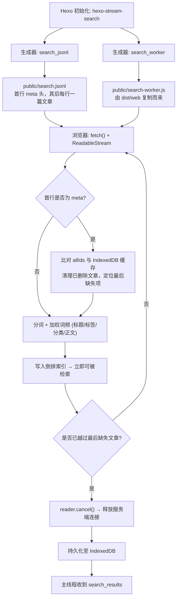

<div align="center">

# 🔍 hexo-stream-search

**面向 Hexo 7 与 Hexo 8 的流式、增量、零依赖全文搜索方案。**  
基于 **JSONL 流式索引** + **Fetch Stream** + **Intl.Segmenter** + **BM25** + **IndexedDB** 驱动。

[](https://www.npmjs.com/package/hexo-stream-search)
[](https://github.com/Wyatex/hexo-stream-search/actions/workflows/ci.yml)
[](https://nodejs.org/)
[](https://hexo.io/)
[](https://www.npmjs.com/package/hexo-stream-search)
[](LICENSE)

[English](./README.md) • [简体中文](./README.zh-CN.md)

</div>

---

## 🌟 核心亮点

- ⚡ **边下载边可搜**：JSONL 索引逐行解析，文章一到达就立刻进入倒排索引，无需等待整个文件下载完成。
- 🔄 **增量同步**：首行携带全站文章 ID 列表，未变更的文章直接复用本地缓存（不重复分词），服务端已删除的文章自动清理，并在剩余文章均已是最新时**提前 cancel 断流**。
- 💾 **秒开体验**：文章持久化在 IndexedDB 中，二次访问立即构建可检索索引，增量更新在后台静默流式完成。
- 🌐 **原生级中文分词**：基于 V8 原生 `Intl.Segmenter` 精准切分中英文，并自动规范化技术词汇（`C++` → `cpp`、`C#` → `csharp`）。
- 📊 **字段感知 BM25**：标题、标签、分类、正文分别加权统计词频，并在标准 BM25 之上叠加短语精确命中、前缀回退与全词覆盖加成。
- 📦 **零运行时依赖**：纯 Web API 实现（`fetch`、`ReadableStream`、`Intl.Segmenter`、`IndexedDB`），无需下载词典，无需 `natural` 式百兆安装，无需原生编译。
- 🧩 **构建产物清晰分段**：`dist/node`（Hexo 构建侧）与 `dist/web`（浏览器运行侧）完全隔离，Node 产物不含任何浏览器代码，反之亦然。
- 🧪 **真实 Hexo 双版本验证**：针对 **Hexo 7.3.0** 与 **Hexo 8.1.2** 的完整集成测试，另有覆盖 **Node 18 → 26** 的零依赖运行时冒烟测试。

---

## 📊 与 `hexo-generator-searchdb` 对比

| 特性 | `hexo-generator-searchdb` | `hexo-stream-search` |
|:---|:---:|:---:|
| **索引产物** | 单个庞大的 `search.json` 数组 | **可流式解析的 `search.jsonl`**（meta 头 + 每行一篇文章） |
| **传输方式** | 整文件一次性下载 | **Fetch Stream 逐行流式解析** |
| **可检索时机** | 必须等整个文件下载并解析完成 | **第一篇文章到达即可检索** |
| **增量更新** | 不支持——没有 id / 时间戳字段，每次部署都要全量重建并重新下载 | **meta 头 + `m` 时间戳比对，未变更文章复用本地缓存** |
| **本地缓存** | 整份 JSON 塞进 `localStorage`（体积大、每次都要重新反序列化） | **按文章逐条存入 IndexedDB，到达即建索引** |
| **已删除文章** | 需重新下载整个索引后才发现 | **通过 meta 头比对立即清理** |
| **匹配方式** | 查询词拆分后做子串 AND 匹配 | **分词 + BM25 相关性打分** |
| **中文支持** | 无——中文只能命中连续片段 | **原生 `Intl.Segmenter` 中英文分词** |
| **排序质量** | 命中次数 / 包含次数（与真实相关性关联很弱） | **BM25 + 标题/标签/分类加权 + 短语、前缀、全词覆盖加成** |
| **结果摘要** | 仅高亮标题，无上下文 | **自动定位命中位置生成带上下文的摘要（`<mark>` 高亮）** |
| **搜索计算位置** | 主线程（大文章量下阻塞 UI） | **Web Worker（完全不阻塞主线程）** |
| **页面 (pages) 支持** | `field: post / page / all` | 目前仅收录文章（pages 暂未纳入索引） |
| **配置块** | `search.path / field / content / format` | `search.path / worker`（兼容 `field`） |
| **主题接入** | 依赖主题内置的 `local-search.js` | **协议一致，并额外提供与 DOM 解耦的 client** |
| **运行时依赖** | `hexo-util` + `nunjucks` | **零依赖** |
| **TypeScript 类型** | 无 | **两套产物均提供完整类型声明** |
| **Hexo 7 & 8** | 未做双版本验证 | **Hexo 7.3 与 8.1 集成测试覆盖，另有 CI 矩阵** |

> [!NOTE]
> 两个插件都读取同一个 `search` 配置块。若 `hexo-generator-searchdb` 仍在依赖中，请移除——当两者指向同一个文件（例如 `search.path: search.json`）时，两个生成器会写入同一路径；此外 `searchdb` 在配置的路径没有扩展名时还会强制补上 `.json`。

---

## 🏗️ 架构流程



---

## 📦 安装指南

在您的 Hexo 博客项目根目录下运行：

```bash
# 使用 npm
npm install hexo-stream-search --save-dev

# 使用 pnpm
pnpm add -D hexo-stream-search

# 使用 yarn
yarn add -D hexo-stream-search
```

> [!TIP]
> Hexo 会自动扫描并加载以 `hexo-*` 开头的插件依赖，无需在 `_config.yml` 的 `plugins` 中手动声明！

---

## ⚙️ 参数配置

在博客根目录的 `_config.yml` 中添加 `search` 配置块：

```yaml
search:
  path: search.jsonl         # 索引文件路径（相对站点根目录）
  worker: search-worker.js   # Worker 脚本路径（相对站点根目录）
```

### 完整配置项详解

| 参数键名 | 类型 | 默认值 | 说明 |
|:---|:---:|:---:|:---|
| `search.path` | `string` | `'search.jsonl'` | 生成的 JSONL 索引路径。前导 `/` 会被去掉，文件始终输出到站点根目录。 |
| `search.worker` | `string` | `'search-worker.js'` | 复制到站点根目录的浏览器 Worker 脚本路径。 |
| `search.field` | `string` | `'post'` | 兼容 `hexo-generator-searchdb` 风格配置保留。 |

主题侧通过 `CONFIG.path` 获取索引地址（NexT 主题为 `url_for(config.search.path)`）。

---

## 📄 索引格式（`search.jsonl`）

首行为全局元数据（Meta Header），其余每行一篇文章：

```jsonc
{"_type":"meta","total":186,"allIds":["a/","b/"]}
{"id":"a/","t":"标题","u":"/a/","m":1793027367870,"g":["标签"],"k":["分类"],"c":"纯文本正文"}
```

| 字段 | 类型 | 说明 |
|:---|:---:|:---|
| `_type` | `'meta'` | 标识 meta 头（仅首行）。 |
| `total` | `number` | 参与索引的已发布文章总数。 |
| `allIds` | `string[]` | 全部有效文章 ID，顺序与数据行一致。 |
| `id` | `string` | 唯一主键（Hexo 的 `post.path`）。 |
| `t` | `string` | 清洗后的纯文本标题。 |
| `u` | `string` | 文章在站点内的绝对链接。 |
| `m` | `number` | 修改时间戳（毫秒），用于增量比对。 |
| `g` / `k` | `string[]` | 标签 / 分类。 |
| `c` | `string` | 纯文本正文（剥离 HTML、还原实体、压缩空白）。 |

文章按修改时间**降序**排列；草稿与 `indexing: false` 的文章会被排除。

---

## 🎨 主题集成指南

### 1. 原生 Worker 协议

```html
<script>
  const worker = new Worker('/search-worker.js')
  worker.postMessage({ type: 'INIT', payload: { url: '/search.jsonl' } })

  worker.onmessage = (event) => {
    const { type, payload } = event.data
    if (type === 'progress') console.log(`已加载 ${payload.loaded}/${payload.total}`)
    if (type === 'sync_complete') console.log('索引就绪', payload)
    if (type === 'search_results') console.log(payload.results)
  }

  worker.postMessage({ type: 'SEARCH', payload: { query: '流式搜索', limit: 20, requestId: 1 } })
</script>
```

### 2. 与 DOM 解耦的客户端（推荐）

包内客户端已处理输入防抖、`requestId` 竞态、流式期间的自动重搜以及 Worker 生命周期：

```js
import { createSearchClient } from 'hexo-stream-search/client'

const client = createSearchClient({
  workerUrl: '/search-worker.js',
  jsonlUrl: '/search.jsonl',
  limit: 20,
  onProgress: ({ loaded, total }) => renderProgress(loaded, total),
  onSyncComplete: ({ totalDocs }) => console.log(`已索引 ${totalDocs} 篇文章`),
  onResults: ({ results, elapsedMs }) => renderResults(results, elapsedMs),
  onError: (message) => console.error(message),
})

client.init()
input.addEventListener('input', (event) => client.search(event.target.value))
```

若使用普通 `<script>` 标签，请引入 IIFE 版本，它会暴露全局变量 `HexoStreamSearch`：

```html
<script src="/search-client.iife.js"></script>
<script>
  const client = HexoStreamSearch.createSearchClient({ workerUrl: '/search-worker.js' })
</script>
```

### 3. 开箱即用的演示页

本仓库的 `examples/demo.html` 是完整的独立演示页——把 `search-worker.js`、`client.iife.js` 与 `search.jsonl` 放在同一目录即可在浏览器中打开。

---

## 🔌 消息协议

### 主线程 → Worker

| 指令 | 载荷 | 说明 |
|:---|:---|:---|
| `INIT` | `{ url?: string }` | 开始同步（默认 `/search.jsonl`）。 |
| `SEARCH` | `{ query: string, limit?: number, requestId: number }` | 发起检索。 |
| `CLEAR` | — | 清空 IndexedDB 缓存。 |

### Worker → 主线程

| 事件 | 载荷 | 说明 |
|:---|:---|:---|
| `cache_ready` | `{ count, totalTerms }` | 缓存文章已建立索引，可立即检索。 |
| `progress` | `{ loaded, total, percent, updated, scanned }` | 流式同步进度（40ms 节流上报）。 |
| `sync_complete` | `{ totalDocs, totalTerms, updatedCount, deletedCount, scannedLines, canceledEarly, elapsedMs }` | 同步完成。 |
| `search_results` | `{ query, requestId, results, elapsedMs }` | 检索结果。 |
| `cleared` | `true` | 缓存已清空。 |
| `error` | `string` | 错误信息。 |

---

## 🔬 排序模型

引擎以 **BM25** 为基础分，并叠加字段感知加成。

### 1. 逆文档频率 (IDF)
$$\text{IDF}(w) = \ln\left(1 + \frac{N - DF(w) + 0.5}{DF(w) + 0.5}\right)$$

### 2. 词频饱和度与篇幅归一化 (TF Saturation)
$$\text{TF}_{\text{BM25}}(w, D) = \frac{\text{freq}(w, D) \cdot (k_1 + 1)}{\text{freq}(w, D) + k_1 \cdot \left(1 - b + b \cdot \frac{|D|}{\text{avgdl}}\right)}$$
*标准参数取值：$k_1 = 1.5$，$b = 0.75$。*

### 3. 字段权重与加成项

| 信号 | 取值 |
|:---|:---:|
| 字段权重（折算进词频） | 标题 **4.0** / 标签 **3.0** / 分类 **2.5** / 正文 **1.0** |
| 标题包含完整查询词 | **+8.0**（标题以查询词开头再 **+4.0**） |
| 正文短语精确命中 | **+4.0** |
| 命中全部查询词 | **×1.6**（并乘词条协同系数 $0.5 + 0.5 \cdot coverage$） |
| 英文前缀回退（如 `types` → `typescript`） | 自动生效 |

多词查询会自动过滤高频中文停用词；所有高亮在包裹 `<mark class="search-keyword">` 之前都会先做 HTML 转义。

---

## 🛠️ 编程式 API

### Node 端

```typescript
import { buildJsonl, cleanText, registerGenerators } from 'hexo-stream-search'

// 由 Hexo 文章数据构建 JSONL 索引
const jsonl = buildJsonl(
  [
    {
      path: 'posts/docker-k8s/',
      title: 'Docker 与 Kubernetes 进阶实战',
      content: '<p>容器化编排与微服务网络治理深入剖析。</p>',
      updated: 1793027367870,
      tags: [{ name: 'DevOps' }],
      categories: [{ name: '云原生' }],
    },
  ],
  { root: '/' },
)
// jsonl → {"_type":"meta","total":1,"allIds":["posts/docker-k8s/"]}\n{"id":"posts/docker-k8s/", ...}

// 剥离 HTML、还原实体
cleanText('<p>Hello&nbsp;&amp;&nbsp;World</p>') // → 'Hello&nbsp; World'

// 手动注册生成器（被 Hexo 加载时会自动注册）
registerGenerators(hexo)
```

### 浏览器端

```typescript
import { createSearchClient } from 'hexo-stream-search/client'

const client = createSearchClient({
  workerUrl: '/search-worker.js',
  jsonlUrl: '/search.jsonl',
  debounceMs: 90,                 // 输入防抖
  autoRefreshWhileSyncing: true,  // 索引仍在流式加载时自动重搜
  onResults: ({ results }) => console.log(results),
})

client.init()
client.search('流式搜索')
await client.clearCache()
client.destroy()
```

---

## 🧪 自动化测试

项目基于 [Vitest](https://vitest.dev/) 构建了完善的测试用例体系，覆盖以下维度：

- HTML 清洗、实体还原与空白压缩
- `Intl.Segmenter` 分词、技术词汇规范化与无 Segmenter 兜底路径
- BM25 打分、字段权重、短语加成与前缀回退命中
- JSONL 流式处理：跨块半行、meta 头比对、提前 `reader.cancel()`、已删除文章清理
- IndexedDB 持久化、版本升级与内存降级路径
- Worker 协议载荷与客户端防抖 / 竞态处理
- **Hexo 7.3.0** 与 **Hexo 8.1.2** 真实生命周期集成测试
- 针对已构建 `dist` 的零依赖运行时冒烟测试

```bash
# 执行全部单元与集成测试
pnpm test

# 执行 TypeScript 类型检查
pnpm typecheck

# 编译打包 Node 与 Web 两套产物
pnpm build

# 对构建产物执行冒烟测试
pnpm smoke
```

### CI 与发布

- `.github/workflows/ci.yml`
  - `build-and-test` —— 在 **Node 22 / 24 / 26** 上执行类型检查 → 构建 → 完整测试，并上传 `dist` 产物。
  - `runtime-compatibility` —— 下载产物并在 **Node 18 / 20 / 22 / 24 / 26** 上执行 `tests/smoke.cjs`。
- `.github/workflows/release.yml` —— 推送 `v*` 标签时自动构建、测试、以 `--provenance` 发布到 npm，并创建附带 `dist` 产物的 GitHub Release。

---

## 🛡️ 优雅降级策略

| 场景 | 行为 |
|:---|:---|
| 浏览器不支持 `Intl.Segmenter`（如 Safari < 16.4） | 自动改用正则兜底分词（中文按二元组切分），结果依然可用，精度略有下降。 |
| IndexedDB 不可用（隐私模式、禁用存储） | 自动降级为内存缓存，行为完全一致，仅不跨会话持久化。 |
| 流式传输中途中断 | 已建立的内存索引保留并继续可搜。下次访问仍从文件开头重新拉取，但**不会重复分词**已缓存的文章，并在越过最后一个缺失文章后立即断流——因此实际只需重新传输变动部分。 |
| 构建时 Worker 产物缺失 | `search_worker` 生成器给出警告并跳过，不会中断整站构建。 |

---

<a id="known-issue"></a>

## ⚠️ 已知缺陷：内容变更的文章可能被提前断流跳过

**现象** — 某篇文章内容修改后，搜索索引中**仍然是旧内容**，且刷新页面后依旧陈旧。

**根因** — 提前断流逻辑只统计本地缓存中**完全缺失**的文章（`lastMissingIndex`）。一篇**已经在缓存里、但 `m` 发生了变化**的文章，并不会推高这个标记，于是客户端可能在读到它之前就断流：

```
文件顺序（按 updated 降序）：  [B 未变更] [A m 已变更] [C 未变更]
                               ^ 在此断流 → A 永远不会被重新索引
```

**为什么很少触发** — 编辑文章时 `updated` 会自动变成当前时间，于是它会被排到文件**最前面**，即断流点之前，必然被重新处理。只有当 front-matter 里显式写死了旧的 `updated:` 日期（如 `updated: 2024-01-01`），或两篇文章 `updated` 完全相同导致构建间排序不稳定时，才会踩到这个缺陷。

**影响** — 概率低，但陈旧条目会自我延续：之后每次同步都在同一位置断流。

**临时规避** — 让 Hexo 自动维护时间戳（front-matter 中不要写 `updated:`），文章即会排到索引头部并被正确重新索引。

**计划修复** — 在 meta 头中附带前 N 篇文章的 `{ id, m }` 快照，让客户端**精确计算**首个不一致位置，而不是靠推测。详见下方路线图。

---

## 🗺️ 路线图

- [ ] **索引文件的 fetch 断点续传** —— 通过 `Range: bytes=<offset>-`（配合 `If-Range` / `ETag`）让中断的同步从最后收到的字节继续，而不是每次都从文件开头重新流式拉取。落地需要：把索引的 `ETag` / `Last-Modified` 暴露给客户端、把已接收字节偏移持久化到 IndexedDB，以及在服务端不支持 Range 时优雅回退到当前的全量流式行为。
- [ ] **精确的差异检测** —— 在 meta 头中下发前 N 篇文章的 `{ id, m }` 快照，让断流点被精确计算，从而修复上面的[已知缺陷](#known-issue)。
- [ ] **同时索引 pages** —— `hexo-generator-searchdb` 支持通过 `search.field: page | all` 索引 `locals.pages`，本包目前仅收录文章。

---

## 🔄 从 `hexo-generator-searchdb` 迁移

1. 从站点依赖中移除 `hexo-generator-searchdb`——它同样注册生成器并读取同一个 `search` 配置块，两者会争抢同一个输出文件。
2. 引入本包：`"hexo-stream-search": "file:../path/to/hexo-stream-search"`（或直接使用已发布版本）。
3. 删除手写的 `scripts/jsonl-generator.js` 与 `search-worker.js`。
4. 让主题指向新的索引——NexT 通过 `CONFIG.path` 获取，来源即 `search.path`（默认 `search.jsonl`）。
5. 主题脚本可继续使用原协议，也可改用 `hexo-stream-search/client` 复用防抖与自动重搜逻辑。

---

## 📄 开源许可证

本项目遵循 [MIT](./LICENSE) 许可证发布。版权所有 © [Wyatex](https://github.com/wyatex)。
